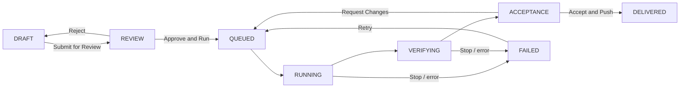

# Erupt AI Dev <Badge type="tip" text="v2.4.0+" />

erupt-ai-dev brings coding agents into the delivery process: a **project** spans several git repositories, requirements enter a **requirement pool**, and once approved a **coding CLI** installed on the server (Claude Code, Codex, OpenCode, ...) implements them in a worktree of their own.
An optional QA agent checks the change, then a human accepts it and pushes. Execution is server-managed; every git operation goes through the support module erupt-git, which speaks only the git protocol, so GitHub, GitLab, Gitee, Gitea or a plain git server all work.

> Minimum version: **2.4.0**

:::info Repository
[https://github.com/erupts/erupt/tree/master/erupt-ai/erupt-ai-dev](https://github.com/erupts/erupt/tree/master/erupt-ai/erupt-ai-dev)
:::

## Setup

1. Add the dependency (requires [erupt-ai](/en/modules/erupt-ai/); it pulls in the support module `erupt-git`, so git 2.20+ must be on the server's PATH):

```xml
<dependency>
    <groupId>xyz.erupt</groupId>
    <artifactId>erupt-ai-dev</artifactId>
    <version>${erupt.version}</version>
</dependency>
```

`erupt-spring-boot-starter-all` already includes this module.

2. Install at least one coding CLI on the server that will run agents (see [Executors and Coding CLIs](#executors-and-coding-clis)) and put its API key under `erupt.ai-dev.executor.env`.

3. After startup a new **AI Dev** menu group appears with **Requirement Pool** and **Dev Project**. The **Requirement** menu exists but stays hidden: the pool page writes through its add API and row operations, so validation, permissions and the operation log remain erupt's own.

## Lifecycle



A requirement without QA review skips VERIFYING and goes from RUNNING straight to ACCEPTANCE. Stages move only through the actions below, never by editing the record; the definition is frozen while a requirement is queued, running or delivered.

| Action | From | Who | Effect |
|---|---|---|---|
| **Submit for Review** | DRAFT | any member | REVIEW; the reviewer is notified |
| **Approve and Run** | REVIEW | reviewer / owner / maintainer | QUEUED; an optional note goes to the agent; the approver becomes the reviewer when none was assigned |
| **Reject** | REVIEW | reviewer / owner / maintainer | back to DRAFT, **a reason is required** |
| **Stop** | RUNNING / VERIFYING | any member | kills the agent process, FAILED |
| **Retry** | FAILED | any member | QUEUED, with an optional instruction; the agent resumes its previous session |
| **Request Changes** | ACCEPTANCE | reviewer / owner / maintainer | QUEUED, **the instruction is required**; the agent resumes its previous session |
| **Accept and Push** | ACCEPTANCE | reviewer / owner / maintainer | rebases and pushes every repository; DELIVERED on success |
| **Cancel** | not RUNNING / VERIFYING / DELIVERED | any member | CANCELLED; the workspace is discarded |
| **Clean Up Workspace** | DRAFT / REVIEW / FAILED / CANCELLED | any member | removes worktrees, uncommitted changes and the local branch; the next run starts from the latest base |
| **Change Priority** | any | any member | priority is scheduling, not definition |
| **Delete** | not QUEUED / RUNNING / VERIFYING / DELIVERED | creator / owner / maintainer | removes the requirement with its sessions, logs, deliveries and workspace; nothing pushed is touched |

:::tip Four eyes
By default the creator of a requirement cannot approve or reject it: another reviewer has to. Turn on **Self Review** in the project to allow it.
:::

### Notices

With [erupt-notice](/en/modules/erupt-notice) on the classpath, stage changes are sent as in-app notices (scene code `ai_dev`) that link straight to the requirement. The person who took the action is never told about it:

| Event | Receivers |
|---|---|
| Submitted | the assigned reviewer, else every reviewer, owner and maintainer of the project |
| Approved / Rejected | the creator (the body carries the reviewer's comment) |
| Acceptance / Failed / Delivered | creator and reviewer |

Requirements still RUNNING or VERIFYING when the server restarts are marked FAILED ("Interrupted by a server restart"); a retry continues them.

## Projects

Created under the **Dev Project** menu. The project list shows a user only the projects they created (super admins see all); the pool follows membership.

| Field | Description |
|---|---|
| **Code** | Unique identifier, also the directory name on the server: lower case letters, digits and `-`; cannot be changed later |
| **Name** | Display name |
| **Repositories** | The git repositories the project spans, see below |
| **Members** | Only members see the project, see below |
| **Self Review** | Off by default: the creator of a requirement cannot approve or reject it |
| **AGENTS.md** | Markdown project instructions. Written into the workspace root of every agent run, next to the repositories, together with a CLAUDE.md that reads `@AGENTS.md`, so Claude Code and Codex both pick it up |
| **Active Workspaces** | Requirement workspaces of the project still on the server |

Row operations: **Sync Repositories** (re-fetches the bare clones; saving the project also syncs them in the background) and **Clean Up Leftover Workspaces** (removes the workspaces of delivered, cancelled and since-deleted requirements; owners and maintainers only).

### Repositories

| Field | Description |
|---|---|
| **Alias** | Directory name inside the workspace, e.g. `web` or `api`: lower case letters, digits and `-` |
| **Git URL** | `https`, `ssh` or `git@host:org/repo.git`; **never put credentials in the URL**, such a URL is refused |
| **Base Branch** | Worktrees start from the latest origin of this branch; blank takes the remote's default branch. Focusing the field lists the remote's branches |
| **Target Branch** | Branch a delivery is pushed to after rebasing; blank pushes to the requirement's own branch `req/req-n` |
| **Credential** | Key of an entry under `erupt.ai-dev.credentials`; blank for public repositories |
| **Sync Status / Message / Synced At** | State of the server-side bare clone: PENDING, SYNCING, READY, FAILED |

Saving validates the URL, the branch names, that the credential exists and may be used for that host, and that the base branch really is on the remote.

### Members and Roles

| Role | Permissions |
|---|---|
| **OWNER** | Manages settings, repositories and members; the creator becomes an owner automatically |
| **MAINTAINER** | Same as owner |
| **REVIEWER** | Approves / rejects requirements, requests changes, accepts and pushes |
| **MEMBER** | Sees the project, creates requirements, submits / retries / stops / cancels |

A non-member never lists, opens or picks a project; super admins see all. A project keeps at least one owner or maintainer. Every entity carries a tenant id, and every path on disk is prefixed with the tenant.

### Workspaces

```
{root}/repos/{tenant}/{project}/{alias}.git            bare clone, synced in the background after each save
{root}/worktrees/{tenant}/{project}/{req-n}/{alias}    worktree; {req-n} is the agent's working directory
```

A requirement's workspace (one worktree per repository on the branch `req/req-n`) lives as long as it can still run: delivery removes it, and so does cancelling. The requirement page shows it per repository (present or not, commits ahead of the base, uncommitted files; the server path for super admins). Every path segment is validated and checked against the root.

## Requirement Pool

**AI Dev → Requirement Pool** opens `#/ai-dev/pool`. The page header picks the current project. The list comes as a **table** or a **board** (remembered per browser), filtered by "All / Mine / To review", grouped by status (To do, In progress, Awaiting acceptance, Failed, Delivered, Cancelled) and searchable by code or title. Active requirements refresh every 5 seconds.

The **New requirement** dialog:

| Field | Description |
|---|---|
| **Title** | One line on what should change |
| **Description** | Markdown: background, expected behaviour and acceptance criteria; the agent works from this text |
| **Priority** | HIGH / MEDIUM / LOW |
| **Repositories** | At least one; each gets its own worktree |
| **Executor** | Only the coding CLIs installed on the server, preselecting the one you used last in this project |
| **Model** | Model id passed to the executor, blank for its default; CLIs that can list their models get suggestions |
| **QA review** | A second run checks the change before acceptance |

The detail page has four steps, **Define / Review / Run / Deliver**:

- **Define**: the requirement document, read-only while it runs; plus the workspace state of every repository.
- **Review**: the review history (who approved or rejected, comment, time). A rejection needs a reason; an approval may carry a note that is handed to the agent with the requirement.
- **Run**: the sessions (developer, QA and each retry are one session each, with status, time spent, tokens and cost) and the agent log followed live: prompt, text, tool calls with their results, final answer. Agent output is shown as text only, never rendered as HTML. When failed or awaiting acceptance, a composer at the bottom sends an instruction and the agent resumes its last session.
- **Deliver**: the diff of every repository against its base branch, in **unified** or **split** layout, with a file navigator, a file-name filter and per-file folding; below it the deliveries per repository (branch, commit, status, message). A very large diff shows only its beginning, the file list stays complete.

Each repository carries its delivery state in the list and the detail: not pushed, pushed (→ branch), no changes, conflict, rejected, failed.

### Project scope with @EruptScope

`DevProjectScope` is an [@EruptScope](/en/annotation/erupt-scope) form whose only field is a "Current Project" choice of the user's own projects. `DevRequirement` declares it, so the page header picks a project once and every list, detail and write follows it. The options are re-checked on every request, so a hand-edited `erupt-scope` header cannot reach a project the user is not a member of.

The pool's read API lives under `/erupt-api/ai-dev/pool/*`, guarded by the page's menu and by project membership.

## Executors and Coding CLIs

One run goes through these steps:

1. The executor polls the queue (every 10 seconds by default) and claims a QUEUED requirement with a conditional update, so two instances never take the same one.
2. **Workspace**: each repository is fetched and a worktree on `req/req-n` is checked out from `origin/<base branch>`; AGENTS.md and CLAUDE.md are written. A retry keeps the existing worktree.
3. **Developer agent**: the requirement's executor runs in the workspace with the prompt on stdin. Every message (text, tool call, tool result, final answer) is stored as an **Agent Event** as it arrives. A retry or a change request resumes the previous CLI session (`--resume`) and passes the new instruction.
4. Anything the agent left uncommitted is committed in its name (`agent@erupt.local`), so nothing is lost.
5. **QA review** (optional): a second run of the same executor inspects the change read-only and reports its verdict through the MCP tool `devReportVerdict`.
6. **ACCEPTANCE**: a human reviews.

:::warning Installed means enabled
There is no `executor.enabled` switch: **an instance runs agents as soon as a coding CLI is installed on it**, and approving a requirement needs its executor on the current instance. The server's PATH (or a configured absolute path) is rescanned every 30 seconds, so a CLI installed later shows up in the picker without a restart.
:::

| Code | CLI | Headless mode | Session resume | MCP |
|---|---|---|---|---|
| `claude` | Claude Code | `claude -p --output-format stream-json` | yes | `--mcp-config` file |
| `codex` | Codex | `codex exec --json` | yes | `-c mcp_servers.erupt.*`, token in the environment |
| `opencode` | OpenCode | `opencode run --format json --standalone` | yes | `OPENCODE_CONFIG_CONTENT` |
| `kimi` | Kimi Code | `kimi --print --output-format stream-json` | yes | `--mcp-config-file` |
| `cursor` | Cursor CLI | `cursor-agent -p --output-format stream-json --force`, prompt as the last argument | yes | no: marker lines |
| `qwen` | Qwen Code | `qwen --output-format stream-json --yolo` | yes | no: marker lines |
| *any key* | a plain CLI | prompt on stdin (or as the last argument), text out | no | no: marker lines |

Claude Code, Cursor CLI and Qwen Code print the same stream-json, read by one parser (`StreamJsonRunner`).

A built-in CLI takes its `binary`, `label`, `args` and `icon` (an image URL; without one the page draws a badge of its initials) from `executor.clis.<code>` when set. Any other key adds a plain CLI, so other tools need no code:

```yaml
erupt:
  ai-dev:
    executor:
      clis:
        # args: that CLI's own non-interactive flags
        zcode: {binary: zcode, label: Z Code, args: ["-p"]}
```

A CLI without a closing result event is judged by its exit code, its last text being the answer. For a CLI that needs real parsing, implement `CodingAgentRunner` as a Spring bean.

## Progress over MCP


Each run reaches erupt-ai's [MCP endpoint](/en/modules/erupt-ai/mcp-server) at `/mcp` with a token of its own:

- **Token**: a random bearer token, minted for the run and revoked when it ends. `DevMcpGrants` is an `McpAuthenticator`, so the token works whether or not `erupt.ai.mcp.server-enabled` is on, and it lists and calls only the tools of its role.
- **Config file**: the agent's `--mcp-config` file is written under `{root}/run/` with mode 0600 and deleted after the run.
- **Isolation**: `--strict-mcp-config` keeps the account's other MCP servers out of the run.
- **Tools**: `DevTools` is an `@AiToolbox(exposed = false)` bean, so chat agents and user tokens never see them. `devRequirement` serves both roles; `devReportProgress` the developer; `devReportVerdict` the QA agent.
- **erupt's own tools**: the run also gets erupt's `@AiToolbox` tools, **acting as the requirement's creator in their tenant**, limited to what that creator's AI roles allow in AI chat: the agent reads erupt models and their data the way the creator could, no further. What it reads goes to the model provider with the rest of its context.
- **Reach**: a token touches only its own requirement.
- **Address**: `http://127.0.0.1:<port><context-path>/mcp` by default. When the agent runs elsewhere, in a container for example, set `executor.mcp-url`.

A CLI without MCP uses marker lines instead: the developer prints `PROGRESS <0-100> <phase>` on a line of its own (phases assess, design, implement, verify), and the QA agent ends with `VERDICT: PASS` or `VERDICT: FAIL <reason>`. Progress only rises, and 100% is kept for the end of the run.

Follow a session live with `GET /erupt-api/ai-dev/session/{id}/events?after={seq}`, at most 500 lines per call.

## Acceptance and Delivery

With **QA review** on, the same executor runs once more after the developer: it reads the change, runs the tests that cover it, checks every acceptance criterion and reports PASS or FAIL with a reason. The verdict shows on the requirement; a failed one is flagged "QA failed" in the list, but whether to push stays a human decision.


**Accept and Push** is for reviewers, owners and maintainers:

1. Every repository is fetched; a repository with a target branch gets `req/req-n` rebased onto `origin/<target branch>`.
2. **Nothing is pushed until every repository rebased cleanly**: one conflict stops all of them, the conflicting files are recorded in the deliveries and the status message, and the requirement stays in ACCEPTANCE for a change request.
3. A repository with a target branch is pushed **fast-forward only** (never forced); one without gets `req/req-n` pushed; a repository without changes is skipped.
4. Each push is recorded as a **Delivery**; once all succeed the requirement is DELIVERED and the worktrees are removed (the branches stay).

| Delivery status | Meaning |
|---|---|
| `PUSHED` | pushed, or the remote was already up to date |
| `SKIPPED` | the repository has no changes |
| `CONFLICT` | rebasing onto the target branch conflicted, nothing pushed |
| `REJECTED` | refused by the remote, typically a protected branch |
| `FAILED` | the push failed, e.g. the target branch moved on after the rebase |
| `PENDING` | not pushed because another repository conflicted |

## Running Agents Safely

An agent edits files and runs commands with the server's account, so:

- Install a CLI on one instance only, ideally a container or VM dedicated to it.
- The agent process starts from a **clean environment**: `PATH`, `HOME`, `LANG` and the like, plus `erupt.ai-dev.executor.env` only. Server secrets such as database passwords never reach it.
- **Git credentials never reach it either**: erupt does every fetch and push itself. A credential goes to git only through the child process environment, never on a command line, in a URL, in `.git/config` or on disk.
- A credential goes only to the hosts listed under `erupt.ai-dev.credentials.<key>.hosts` (`github.com`, `*.example.com`, or `*` for any). **None listed means it is never used**, so a repository URL typed into a project cannot carry it to another server.
- Claude Code also loads the account's own `~/.claude` settings and hooks. Point `CLAUDE_CONFIG_DIR` at a dedicated directory to keep them apart.
- `executor.clis.<code>.args` grants the tools a headless run may use. For Claude Code, `Bash` means any command on that host.
- Repository hooks never run on the server; git commands run as an argument array, never through a shell, with refs and paths validated first.

```yaml
erupt:
  ai-dev:
    executor:
      max-concurrent: 2
      run-timeout-minutes: 60
      env:
        ANTHROPIC_API_KEY: ${ANTHROPIC_API_KEY}
        CLAUDE_CONFIG_DIR: /data/erupt-ai-dev/claude
        GIT_AUTHOR_NAME: Claude Code
        GIT_AUTHOR_EMAIL: agent@erupt.local
        GIT_COMMITTER_NAME: Claude Code
        GIT_COMMITTER_EMAIL: agent@erupt.local
      clis:
        claude:
          binary: claude
          args: ["--permission-mode", "acceptEdits", "--allowedTools", "Read,Edit,MultiEdit,Write,Glob,Grep,Bash"]
```

## Properties

```yaml
erupt:
  ai-dev:
    root: /data/erupt-ai-dev          # repositories and workspaces; blank = ~/.erupt/ai-dev
    credentials:                      # a repository names its entry by key; secrets stay here, never in the database
      github:
        token: ${GITHUB_TOKEN}
        hosts: [github.com]
      internal:
        username: deploy
        password: ${GIT_INTERNAL_PASSWORD}
        hosts: [git.internal.example.com]
      gitlab-ssh:
        ssh-key: /etc/erupt/keys/gitlab
        hosts: ["*.gitlab.example.com"]
    executor:
      max-concurrent: 2               # agent runs at the same time on this instance
      poll-seconds: 10                # how often the queue is checked
      run-timeout-minutes: 60         # a run still going after this is killed
      mcp-url:                        # where the agent reaches the MCP endpoint; blank = http://127.0.0.1:<port>/mcp
      env:                            # added to the agent's clean environment
        ANTHROPIC_API_KEY: ${ANTHROPIC_API_KEY}
      clis:                           # overrides for a built-in CLI, or a new plain CLI
        claude:
          binary: claude              # executable, from PATH unless absolute
          label: Claude Code          # shown in the executor picker
          icon:                       # image URL; blank draws a badge of its initials
          args: [...]                 # extra arguments, replacing the built-in defaults when set
          prompt-as-argument: false   # plain CLI: prompt as the last argument instead of stdin
```

| Property | Default | Description |
|---|---|---|
| `erupt.ai-dev.root` | `~/.erupt/ai-dev` | Root of the bare clones, worktrees and per-run MCP config files |
| `erupt.ai-dev.credentials.<key>` | — | One of `token`, `username` + `password` or `ssh-key`, plus the `hosts` allow-list |
| `erupt.ai-dev.executor.max-concurrent` | `2` | Concurrent runs on this instance |
| `erupt.ai-dev.executor.poll-seconds` | `10` | Queue polling interval |
| `erupt.ai-dev.executor.run-timeout-minutes` | `60` | Timeout of one run |
| `erupt.ai-dev.executor.mcp-url` | local address | MCP endpoint address when the agent does not run on the server itself |
| `erupt.ai-dev.executor.env` | — | Environment of the agent process; the CLI's API key goes here |
| `erupt.ai-dev.executor.clis.<code>` | — | Built-in override or plain CLI: `binary`, `label`, `icon`, `args`, `prompt-as-argument` |

erupt-git's own properties:

```yaml
erupt:
  git:
    binary: git                 # executable, from PATH unless absolute
    timeout-seconds: 600        # per command, clone included
    allow-local-remote: false   # allow file:// remotes
    committer-name: erupt       # committer of commits erupt writes or rebases
    committer-email: erupt@localhost
```

### Tables

| Table | Contents |
|---|---|
| `e_ai_dev_project` | Dev projects (unique per tenant and code) |
| `e_ai_dev_project_repo` | Project repositories |
| `e_ai_dev_project_member` | Project members |
| `e_ai_dev_requirement` | Requirements, numbered `REQ-n` per project by `seq` |
| `e_ai_dev_requirement_review` | Reviews: approval or rejection, comment, reviewer |
| `e_ai_dev_requirement_delivery` | Deliveries: one row per requirement × repository push |
| `e_ai_dev_agent_session` | Agent sessions: role, executor, CLI session id, status, tokens and cost |
| `e_ai_dev_agent_event` | Session log lines, ordered by `seq` |
