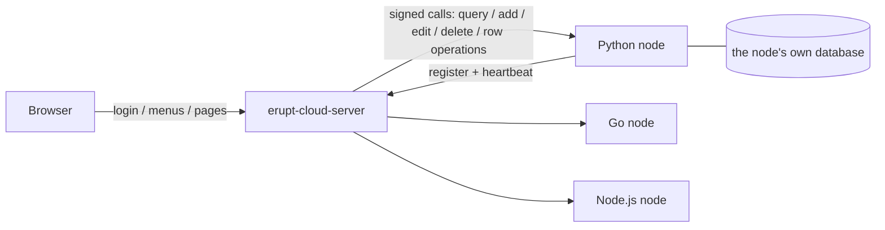

# Erupt SDK for Every Language

Erupt SDK turns models written in any language into erupt admin pages. The service runs as a **node** of [erupt-cloud](/en/modules/erupt-cloud): models and data stay on the node, while the erupt server renders the UI and handles login, menus and permissions. The node only declares its models and reads and writes its data.

> Minimum version: erupt server **2.4.0**. Source and releases at [github.com/erupt-io/erupt-sdk](https://github.com/erupt-io/erupt-sdk).

## How It Works

1. On start the node registers with the server and keeps a heartbeat; it deregisters on exit.
2. A user opens a menu of type `<node>.<Model>` on the server, which reads the node's model definition and renders the table and form.
3. CRUD and row operations are checked for power and payload on the server, then signed and forwarded to the node. References, Excel, uploads, static options and cell edits are done by the server itself; see [What the Server Does for a Node](/en/modules/cloud-server#what-the-server-does-for-a-node).

## Languages

| Language | Runtime | Dependencies | Package | Docs |
| --- | --- | --- | --- | --- |
| Python | 3.9+ | none | `erupt-sdk` (PyPI) | [Python SDK](/en/modules/erupt-sdk/python) |
| Go | 1.21+ | standard library only | `github.com/erupt-io/erupt-sdk/go` | [Go SDK](/en/modules/erupt-sdk/go) |
| TypeScript / Node.js | Node.js 22+ | no runtime dependencies | `erupt-sdk` (npm) | [TypeScript SDK](/en/modules/erupt-sdk/typescript) |
| PHP | 8.1+ | no Composer dependencies | `erupt-io/erupt-sdk` (Packagist) | [PHP SDK](/en/modules/erupt-sdk/php) |
| C# / .NET | .NET 8+ | no runtime NuGet dependencies | `Erupt.Sdk` (NuGet) | [.NET SDK](/en/modules/erupt-sdk/dotnet) |
| Rust | 1.85+ (drivers 1.88+) | serde / serde_json / ctrlc, drivers behind features | `erupt-sdk` (crates.io) | [Rust SDK](/en/modules/erupt-sdk/rust) |
| Ruby | 3.1+ | no gem dependencies, Rack compatible | `erupt-sdk` (RubyGems) | [Ruby SDK](/en/modules/erupt-sdk/ruby) |
| Swift | 5.9+ (macOS 13+ / Linux) | Foundation only, SQLite as an optional product | `EruptSDK` (SwiftPM) | [Swift SDK](/en/modules/erupt-sdk/swift) |
| Java / Kotlin | 17+ | released with erupt, no SDK needed | `erupt-cloud-node` / `erupt-cloud-node-lite` | [Java / Kotlin](/en/modules/erupt-sdk/java) |

:::warning Versions
Every language SDK is currently at **0.1.0** and is released per language by its own tag. Check the package registry for the latest published version before installing.
:::

## What Every SDK Serves

- CRUD with search, sort and paging
- CHOICE, date, date-time, boolean, number, text and other common components, inferred from the language's types
- References with table and tree pickers; the node stores the key and the server resolves labels
- Row operations in single / multi / button mode, with forms, confirm text and per-user visibility
- DataProxy hooks: defaults for a new form, validation, before / after read and write
- The server's per-user power and request signature verification
- Raw annotation attributes passed through, typed and validated against the JSON Schema in `schema/`

The Java node on Spring covers the full annotation surface, including sub-tables, attachments and Excel hooks; what the other languages cover is listed under Limitations on each page.

## Keeping in Step with erupt

The only contract between the two repositories is the `schema/` directory: the annotation JSON Schema (`erupt-annotations.schema.json`) and the field templates (`erupt-node-defaults.json`), generated by erupt from its annotation sources. After an annotation change, erupt-sdk's `sync-schema` workflow pulls the new contract, regenerates every language's code and opens a pull request; each language's CI fails when a generated file no longer matches.

The wire protocol between node and server is [PROTOCOL.md](https://github.com/erupts/erupt/blob/develop/erupt-cloud/PROTOCOL.md).

## Conformance

`conformance/run.py` plays the erupt server: registration with a health probe, per-session power and deregistration, plus the requests the real server forwards. Every language must pass the same checks on the same fixture (the Category, Article and Note models), called both with a plain `Access-Token` and signed. The command for each language is under Examples and Conformance on its page.

## Examples

Every language's `examples/blog` implements the same blog model (articles, categories and a component showcase), so the same admin screens can be compared language by language. Run one, then add `table` menus `blog.Article` and `blog.Category` on the server.
