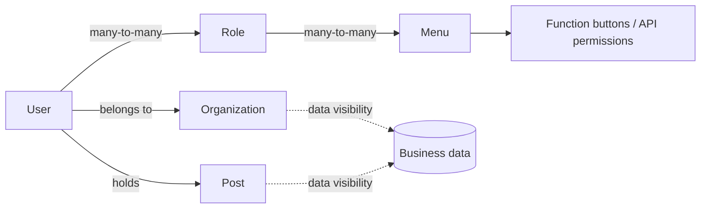

# Erupt UPMS Permission Management

erupt-upms is Erupt's User Permission Management System: users, roles, menus, organizations, posts, dictionaries, Open API, online users and three kinds of logs. Every screen is generated from `@Erupt` annotations, with no UI code to write.

It covers the part every back office needs and nobody should rebuild: **who may log in, which menus they see afterwards, which buttons they may press inside those menus, which data they may see, and how to trace it all later.**

## Adding the Dependency

`erupt-upms` is bundled inside `erupt-admin`, so nothing extra is needed:

```xml
<dependency>
  <groupId>xyz.erupt</groupId>
  <artifactId>erupt-admin</artifactId>
  <version>${erupt.version}</version>
</dependency>
```

Log in with the default account after startup (change it via `erupt.upms.default-account` / `default-password`, see [Configuration](/en/guide/configuration)):

| Account | Password |
| --- | --- |
| erupt | erupt |

Since 2.4.0 the default account is created only when a database is first initialised (tracked in the `e_upms_module` table); once deleted or given a new password it does not come back on restart.

## Permission Model



- A **menu** is the smallest unit of permission. Each Erupt class maps to one menu, and its add / edit / delete / export buttons are generated as child menus, so ticking one grants it.
- A **role** is a set of menus. A user may hold several roles and the permissions are merged as a union.
- **Organizations and posts** do not take part in menu authorization. They define **data visibility**: once a business entity extends `LookerOrg` / `LookerPostLevel` / `LookerSelf`, non-admins only see rows from their own organization, from lower posts in that organization, or that they created themselves.
- A **super admin** (the "Admin User" switch on a user) bypasses every menu and data filter.

## Feature Guide

The menus created under "System Management" at startup, each with its own page:

| Page | What it solves |
|---|---|
| [Menu Management](/en/modules/erupt-upms/menu) | Which pages, buttons and APIs exist, and how each one opens |
| [Role Management](/en/modules/erupt-upms/role) | Bundle menus into job duties, and stop operators from granting more than they hold |
| [Organizations & Posts](/en/modules/erupt-upms/org-post) | The org tree and post ranks, and the data scopes built on them |
| [User Management](/en/modules/erupt-upms/user) | Account lifecycle: password policy, locking, expiry, IP whitelist, password reset |
| [Data Dictionary](/en/modules/erupt-upms/dict) | Turn enums scattered through code into key-values maintained online |
| [Open API](/en/modules/erupt-upms/open-api) | Issue an APPID + Secret so an external system can call APIs as a given user |
| [Online Users](/en/modules/erupt-upms/online) | Who is signed in right now, from where, and force them out in one click |
| [Login & Operation Logs](/en/modules/erupt-upms/log) | Who did what, when, from where, with what data before the change, how long it took, and whether it failed |
| [System Log](/en/modules/erupt-upms/system-log) | Read live application logs in the browser without a server login |
| [Module Center](/en/modules/erupt-upms/menu#module-center) | Which modules are installed, what each does, where its docs are, and a switch to hide the menus of modules you do not use (2.4.0+) |

## Multi-tenancy and @TenantId

> 2.4.0+

The user, role, organization and post tables each carry a `tenant_id` column, `"0"` for platform rows. The column is annotated with Hibernate's `@TenantId`: a session is bound to one tenant, **every query on these entities is restricted to the session's tenant and every insert is stamped with it**, with no filter to write in business code. The login log, online users, operation log, SSO providers and bindings, comments and revisions carry the same column under the same rule; a login is always logged in the user's own tenant.

Without [erupt-tenant](/en/modules/pro/erupt-tenant/) every row belongs to tenant `"0"` and nothing changes. With it:

- **Business codes are unique per tenant**: the unique constraints on account and on role / org / post code become `(tenant_id, account | code)`, so two tenants may hold the same account name. The old single-column unique indexes (such as the one on `account`) are not dropped by JPA; drop them by hand when upgrading, see the [upgrade guide](/en/guide/upgrade) for the SQL.
- **`UpmsTenantSessions`** runs code in a session of another tenant. `callAs / runAs(tenantId, em -> ...)` hands you an `EntityManager` of that tenant and commits; `callBound / runBound(tenantId, () -> ...)` binds the tenant's session to the current thread, so `EruptDao` and any `@Transactional` service inside run in that tenant without knowing, which is what a scheduler walking every tenant needs. `null` is the platform; a thread that already holds a session cannot act as another tenant.
- **`EruptLambdaQuery.allTenants()`** queries across tenants, for the reads of that one query only; `delete()` is not covered. Loading another tenant's row by id still answers `null` and an insert is still stamped with the session's tenant: both need a session of the right tenant.
- **`UpmsMenuScope` SPI** narrows the menus a user may ever hold beyond what roles grant (the feature set of a tenant's subscription, for instance); it applies to the menu tree a session receives and to the menus a role editor may pick. `null` means nothing narrows them.
- **`UpmsTenantLogin` SPI**, implemented by erupt-tenant, resolves a tenant code to its id, decides whether the tenant may sign in and issues the tenant token, and names the tenant login page; every sign-in that bypasses the tenant's password form (SSO, for one) reaches a tenant through it. Without an implementation every sign-in is the platform's.

```java
@Resource
private UpmsTenantSessions tenantSessions;

// the platform creates an administrator for a tenant
tenantSessions.runAs(tenantId, em -> em.persist(admin));

// a scheduler works through one tenant; the service code need not know about tenants
tenantSessions.runBound(tenantId, () -> orderService.settle());

// a platform operator lists the users of every tenant
eruptDao.lambdaQuery(EruptUser.class).allTenants().list();
```

## Trusted Proxies and the Client IP

The login lock, captcha counter, IP whitelist and the login / operation logs all rely on the client IP. Since 2.4.0 `X-Forwarded-For` is believed only when the direct peer is a **trusted proxy**; the list is read from right to left past every trusted hop to the first address no proxy vouched for. Any other request is taken as the direct peer's own address, so a forged header cannot pick the IP. `Proxy-Client-IP`, `WL-Proxy-Client-IP` and similar headers are no longer read.

```yaml
erupt:
  upms:
    # IPs or CIDRs of trusted proxies, comma separated; default: loopback and the RFC 1918 ranges
    trusted-proxies: 127.0.0.0/8,::1,10.0.0.0/8,172.16.0.0/12,192.168.0.0/16
```

Add your reverse proxy when it sits outside those ranges (a public load balancer, say); an empty value trusts no proxy at all.

## Related Extension Points

Code-level extensions of the permission system live in the Advanced section:

| Need | Page |
|---|---|
| Single sign-on, custom login logic (LDAP / SMS codes), issuing tokens yourself | [Login & Authentication](/en/advanced/auth) |
| Replace the login page | [Login & Authentication → Custom Login Page](/en/advanced/auth#custom-login-page) |
| Require login or a menu permission on your own API | [REST API permissions](/en/advanced/rest-api) |
| Filter data by organization / post / creator | [PreDataProxy and Lookers](/en/advanced/pre-data-proxy) |
| Use a dictionary as dropdown options | [CHOICE → Dictionary options](/en/field-types/choice#dictionary-options) |
| Declare module menus, group and docs link in code | [Plugin Development](/en/advanced/plugin) |
| Multi-tenant SaaS: tenant isolation, tenant login page | [erupt-tenant](/en/modules/pro/erupt-tenant/) |
| Watermark, captcha threshold, session length | [Configuration](/en/guide/configuration) |
