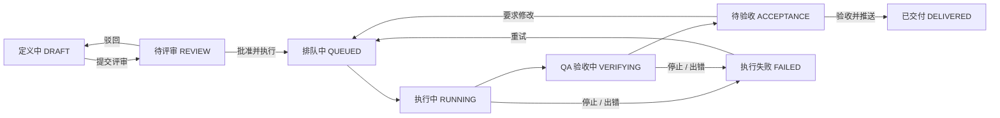

# Erupt Ai Dev AI 软件交付 <Badge type="tip" text="v2.4.0+" />

erupt-ai-dev 把编码 Agent 接进研发流程：一个**项目**横跨多个 git 仓库，需求进入**需求池**，评审通过后由服务器上安装的**编码 CLI**（Claude Code、Codex、OpenCode 等）在独立的 worktree 中实现，
可选 QA Agent 复核，最后由人验收并推送到仓库。执行由服务端统一调度；git 操作全部经由支撑模块 erupt-git 完成，只用 git 协议，所以 GitHub、GitLab、Gitee、Gitea 或自建 git 服务都能用。

> 最低版本要求：**2.4.0**

:::info 仓库地址
[https://github.com/erupts/erupt/tree/master/erupt-ai/erupt-ai-dev](https://github.com/erupts/erupt/tree/master/erupt-ai/erupt-ai-dev)
:::

## 引入方式

1. 添加依赖（需配合 [erupt-ai](/zh/modules/erupt-ai/) 使用；会自动带入支撑模块 `erupt-git`，服务器 PATH 上需有 git 2.20+）：

```xml
<dependency>
    <groupId>xyz.erupt</groupId>
    <artifactId>erupt-ai-dev</artifactId>
    <version>${erupt.version}</version>
</dependency>
```

`erupt-spring-boot-starter-all` 已包含本模块。

2. 在运行 Agent 的那台服务器上安装至少一个编码 CLI（见 [执行器与编码 CLI](#执行器与编码-cli)），并把它的 API Key 放进 `erupt.ai-dev.executor.env`。

3. 启动后新增 **AI 研发** 菜单组，下含 **需求池** 与 **研发项目** 两个菜单。**需求** 菜单以隐藏状态存在：需求池页面通过它的新增接口与行操作写数据，所以校验、权限与操作日志仍由 erupt 自身负责。

## 工作流程



未开启 QA 复核的需求跳过 VERIFYING，RUNNING 结束后直接进入 ACCEPTANCE。阶段只能通过下面的动作推进，不能直接编辑记录；需求处于排队、执行或已交付状态时定义被冻结。

| 动作 | 起始阶段 | 谁可以做 | 效果 |
|---|---|---|---|
| **提交评审** | DRAFT | 任意成员 | 进入 REVIEW，通知评审人 |
| **批准并执行** | REVIEW | 评审人 / 负责人 / 维护者 | 进入 QUEUED；可附一句给 Agent 的说明；未指定评审人时记录批准者为评审人 |
| **驳回** | REVIEW | 评审人 / 负责人 / 维护者 | 退回 DRAFT，**必须填写驳回原因** |
| **停止** | RUNNING / VERIFYING | 任意成员 | 杀掉 Agent 进程，进入 FAILED |
| **重试** | FAILED | 任意成员 | 回到 QUEUED，可附补充指令；Agent 接着上一次会话继续 |
| **要求修改** | ACCEPTANCE | 评审人 / 负责人 / 维护者 | 回到 QUEUED，**必须写明要改什么**；Agent 接着上一次会话继续 |
| **验收并推送** | ACCEPTANCE | 评审人 / 负责人 / 维护者 | rebase 后推送各仓库，成功进入 DELIVERED |
| **取消** | 非 RUNNING / VERIFYING / DELIVERED | 任意成员 | 进入 CANCELLED，同时丢弃工作区 |
| **清理工作区** | DRAFT / REVIEW / FAILED / CANCELLED | 任意成员 | 删除 worktree、未提交改动与本地分支，下次从最新基线重新开始 |
| **调整优先级** | 任意阶段 | 任意成员 | 优先级只影响排序，不属于需求定义 |
| **删除** | 非 QUEUED / RUNNING / VERIFYING / DELIVERED | 创建人 / 负责人 / 维护者 | 连同会话、日志、交付记录与工作区一起删除；已推送的内容不受影响 |

:::tip 四眼原则
默认情况下需求的创建人不能批准或驳回自己的需求，需要由其他评审人处理。项目开启 **允许自审** 后才允许自审。
:::

### 通知

引入 [erupt-notice](/zh/modules/erupt-notice) 后，阶段变化会以站内通知（场景编码 `ai_dev`）推送，点击直达需求详情；操作者本人不会收到自己触发的通知：

| 事件 | 接收人 |
|---|---|
| 提交评审 | 指定的评审人；未指定则项目内所有评审人、负责人与维护者 |
| 批准 / 驳回 | 创建人（正文为评审意见） |
| 待验收 / 执行失败 / 已交付 | 创建人与评审人 |

服务重启时仍处于 RUNNING / VERIFYING 的需求会被标记为 FAILED（"Interrupted by a server restart"），重试即可继续。

## 项目

在 **研发项目** 菜单中创建。项目列表只显示自己创建的项目（超级管理员可见全部）；需求池则按成员关系显示。

| 字段 | 说明 |
|---|---|
| **编码** | 唯一标识，同时是服务器上的目录名：小写字母、数字和 `-`，创建后不可修改 |
| **名称** | 显示名称 |
| **仓库** | 项目横跨的 git 仓库，见下文 |
| **成员** | 只有成员能看到项目，见下文 |
| **允许自审** | 默认关闭：需求创建人不能审批自己的需求 |
| **AGENTS.md** | Markdown 项目说明。每次 Agent 运行时写入工作区根目录（与各仓库并列），并生成一个 `@AGENTS.md` 的 CLAUDE.md，Claude Code 与 Codex 都能读到 |
| **活跃工作区** | 仍留在服务器上的需求工作区数量 |

行操作：**同步仓库**（重新拉取各仓库的裸克隆，保存项目后也会在后台自动同步）、**清理残留工作区**（删除已交付、已取消以及需求已被删除的工作区，仅负责人 / 维护者可用）。

### 仓库

| 字段 | 说明 |
|---|---|
| **别名** | 工作区中的子目录名，例如 `web`、`api`：小写字母、数字和 `-` |
| **Git 地址** | `https`、`ssh` 或 `git@host:org/repo.git`；**不要把凭证写进地址**，带凭证的地址会被拒绝 |
| **基线分支** | worktree 从该分支的最新远程版本创建；留空使用远程默认分支。聚焦输入框即列出远程分支 |
| **目标分支** | 交付时 rebase 后推送到的分支；留空则推送到需求自己的分支 `req/req-n` |
| **凭证** | `erupt.ai-dev.credentials` 下某一项的键名；公开仓库留空 |
| **同步状态 / 同步信息 / 同步时间** | 服务端裸克隆的状态：PENDING、SYNCING、READY、FAILED |

保存时会校验地址、分支名、凭证是否存在、凭证是否允许用于该主机，以及基线分支是否真的在远程上。

### 成员与角色

| 角色 | 权限 |
|---|---|
| **OWNER 负责人** | 管理项目设置、仓库与成员；创建人自动成为负责人 |
| **MAINTAINER 维护者** | 同负责人 |
| **REVIEWER 评审人** | 批准 / 驳回需求、要求修改、验收并推送 |
| **MEMBER 成员** | 查看项目、创建需求、提交 / 重试 / 停止 / 取消 |

非成员看不到、也选不到项目；超级管理员可见全部。项目至少保留一位负责人或维护者。所有实体带租户标识，磁盘路径也以租户为前缀。

### 工作区

```
{root}/repos/{tenant}/{project}/{alias}.git            裸克隆，保存项目后在后台同步
{root}/worktrees/{tenant}/{project}/{req-n}/{alias}    worktree；{req-n} 就是 Agent 的工作目录
```

需求的工作区（每个仓库一个 worktree，分支 `req/req-n`）在还可能继续执行时一直保留：交付成功后移除，取消时也会移除。需求详情按仓库展示工作区状态（是否存在、领先基线的提交数、未提交文件数；超级管理员还能看到服务器路径）。每个路径段都会校验，并确认在 root 之下。

## 需求池

**AI 研发 → 需求池** 打开 `#/ai-dev/pool`。页面头部选择当前项目，支持 **表格** 与 **看板** 两种视图（按浏览器记住），可按「全部 / 我发起的 / 待我评审」筛选，按状态分组（待处理、进行中、待验收、失败、已交付、已取消），按编号或标题搜索。进行中的需求每 5 秒自动刷新。

**新建需求** 对话框：

| 字段 | 说明 |
|---|---|
| **标题** | 一句话说明要做什么 |
| **需求描述** | Markdown：背景、期望效果与验收标准，Agent 以此为依据工作 |
| **优先级** | HIGH / MEDIUM / LOW |
| **涉及仓库** | 至少选一个，每个仓库各建一个 worktree |
| **执行器** | 只列出服务器上已安装的编码 CLI，默认选中你在该项目最近用过的那个 |
| **模型** | 传给执行器的模型 ID，留空用其默认模型；CLI 能列出模型时会给出联想 |
| **QA 复核** | 开发完成后再跑一轮检查改动是否满足需求 |

需求详情分 **定义 / 评审 / 执行 / 交付** 四步：

- **定义**：需求文档，执行期间只读；可查看各仓库的工作区状态。
- **评审**：评审记录（谁批准 / 驳回、意见、时间）。驳回必须填写原因；批准时可附一句给 Agent 的补充说明，会随需求一起交给它。
- **执行**：会话列表（开发、QA、重试各为一次会话，含状态、耗时、token 与费用）与实时跟随的 Agent 日志：提示词、文本、工具调用及其结果、最终结果。Agent 输出只以文本展示，不渲染 HTML。失败或待验收时可在底部输入框补充说明，Agent 接着上一次会话继续。
- **交付**：每个仓库相对基线分支的改动，**统一 / 左右** 两种布局，带文件导航与文件名筛选，可折叠单个文件；下方是按仓库的交付记录（分支、提交、状态、信息）。改动过大时只显示开头部分，文件列表仍完整。

列表与详情中每个仓库都带交付状态标记：未推送、已推送（→ 分支）、无改动、冲突、被拒绝、失败。

### 项目范围 @EruptScope

`DevProjectScope` 是一个 [@EruptScope](/zh/annotation/erupt-scope) 表单，唯一字段是「当前项目」下拉，选项为当前用户所属的项目。`DevRequirement` 声明了它，因此页面头部选一次项目，之后的列表、详情与写入都落在该项目内。选项在每次请求时重新校验，手改 `erupt-scope` 请求头也无法触及自己不是成员的项目。

需求池的读接口在 `/erupt-api/ai-dev/pool/*`，受页面菜单权限与项目成员关系双重保护。

## 执行器与编码 CLI

一次执行的步骤：

1. 执行器轮询队列（默认每 10 秒），用条件更新领取 QUEUED 需求，多实例部署也不会重复领取。
2. **准备工作区**：拉取每个仓库，从 `origin/<基线分支>` 检出分支 `req/req-n` 的 worktree；写入 AGENTS.md 与 CLAUDE.md。重试时沿用已有 worktree。
3. **开发 Agent**：需求的执行器在工作区中运行，提示词经 stdin 传入。每条消息（文本、工具调用、工具结果、最终结果）到达即存为 **Agent Event**。重试与要求修改会用 `--resume` 接着上一次 CLI 会话，并附上新指令。
4. Agent 未提交的改动由 erupt 以 Agent 的名义提交（`agent@erupt.local`），不会丢失。
5. **QA 复核**（可选）：同一执行器再跑一轮，只读检查并通过 MCP 工具 `devReportVerdict` 上报结论。
6. 进入 **ACCEPTANCE**，等待人工验收。

:::warning 安装即启用
没有 `executor.enabled` 这样的开关：**一台实例上装了编码 CLI 就会运行 Agent**，批准需求也要求当前实例装有该需求的执行器。服务器 PATH（或配置的绝对路径）每 30 秒重新扫描，新装的 CLI 无需重启即可出现在选择器中。
:::

| 编码 | CLI | 无头模式 | 会话续接 | MCP |
|---|---|---|---|---|
| `claude` | Claude Code | `claude -p --output-format stream-json` | 是 | `--mcp-config` 文件 |
| `codex` | Codex | `codex exec --json` | 是 | `-c mcp_servers.erupt.*`，token 放在环境变量 |
| `opencode` | OpenCode | `opencode run --format json --standalone` | 是 | `OPENCODE_CONFIG_CONTENT` |
| `kimi` | Kimi Code | `kimi --print --output-format stream-json` | 是 | `--mcp-config-file` |
| `cursor` | Cursor CLI | `cursor-agent -p --output-format stream-json --force`，提示词作为最后一个参数 | 是 | 否，用标记行 |
| `qwen` | Qwen Code | `qwen --output-format stream-json --yolo` | 是 | 否，用标记行 |
| *任意键名* | 普通 CLI | 提示词经 stdin（或最后一个参数）传入，输出文本 | 否 | 否，用标记行 |

Claude Code、Cursor CLI 与 Qwen Code 输出同一种 stream-json，由同一个解析器（`StreamJsonRunner`）读取。

内置 CLI 可通过 `executor.clis.<编码>` 覆盖 `binary`、`label`、`args` 与 `icon`（图片地址，未配置时页面用首字母徽章）。其他任意键名即新增一个普通 CLI，无需写代码：

```yaml
erupt:
  ai-dev:
    executor:
      clis:
        # args 填该 CLI 自己的非交互参数
        zcode: {binary: zcode, label: Z Code, args: ["-p"]}
```

没有结束事件的 CLI 以退出码判定成败，最后一段文本作为结果。需要真正解析输出的 CLI，可实现 `CodingAgentRunner` 接口并注册为 Spring Bean。

## MCP 进度上报


每次运行都会连到 erupt-ai 的 [MCP 端点](/zh/modules/erupt-ai/mcp-server) `/mcp`，使用一枚只属于这次运行的 token：

- **Token**：随机 bearer token，运行开始时签发、结束时吊销。`DevMcpGrants` 实现了 `McpAuthenticator`，所以即使 `erupt.ai.mcp.server-enabled` 关闭，这枚 token 也有效，而且只能列出和调用其角色的工具。
- **配置文件**：Agent 的 `--mcp-config` 文件写在 `{root}/run/` 下，权限 0600，运行结束即删除。
- **隔离**：`--strict-mcp-config` 把账号自己配置的其他 MCP Server 挡在运行之外。
- **工具**：`DevTools` 是一个 `@AiToolbox(exposed = false)` 的 Bean，聊天 Agent 与用户 token 永远看不到它们。`devRequirement` 两种角色都有；`devReportProgress` 给开发 Agent；`devReportVerdict` 给 QA Agent。
- **erupt 自身工具**：运行还会拿到 erupt 的 `@AiToolbox` 工具，**以需求创建人的身份在其租户内运行**，范围限于该创建人的 AI 角色在对话中可用的工具：Agent 能像创建人一样读取 erupt 模型与数据，不会更多。读到的内容会连同上下文一起发给模型服务商。
- **范围**：一枚 token 只能触及它自己的需求。
- **地址**：默认 `http://127.0.0.1:<port><context-path>/mcp`。Agent 在容器等其他位置运行时设置 `executor.mcp-url`。

没有 MCP 的 CLI 用标记行代替：开发 Agent 单独打印一行 `PROGRESS <0-100> <phase>`（阶段为 assess、design、implement、verify），QA Agent 最后打印 `VERDICT: PASS` 或 `VERDICT: FAIL <原因>`。进度只升不降，100% 留给运行结束。

实时跟随会话：`GET /erupt-api/ai-dev/session/{id}/events?after={seq}`，每次最多返回 500 条。

## 验收与交付

**QA 复核** 开启时，开发 Agent 结束后同一执行器再运行一次：只读取改动、运行覆盖到的测试、逐条核对验收标准，并上报 PASS / FAIL 及理由。结论显示在需求的 **QA 结论** 上，未通过的需求在列表中标为「QA 未通过」，但是否推送仍由人决定。


**验收并推送** 由评审人、负责人或维护者执行：

1. 拉取每个仓库；配置了目标分支的仓库先把 `req/req-n` rebase 到 `origin/<目标分支>`。
2. **所有仓库都 rebase 成功后才开始推送**，任一仓库冲突则全部不推送，冲突文件记录在交付记录与状态信息中，需求留在 ACCEPTANCE，可要求 Agent 修改后再试。
3. 有目标分支的仓库 **fast-forward 推送**到目标分支（绝不 force）；没有的推送 `req/req-n` 分支；没有改动的仓库跳过。
4. 每个仓库各记一条 **交付记录**；全部成功后需求进入 DELIVERED，worktree 被移除（分支保留）。

| 交付状态 | 含义 |
|---|---|
| `PUSHED` | 已推送（或远端已是最新） |
| `SKIPPED` | 该仓库没有改动 |
| `CONFLICT` | rebase 到目标分支时冲突，未推送 |
| `REJECTED` | 远端拒绝，通常是受保护分支 |
| `FAILED` | 推送失败，例如目标分支在 rebase 后又前进了 |
| `PENDING` | 因其他仓库冲突而未推送 |

## 安全运行

Agent 用服务进程的账号改文件、跑命令，所以：

- 只在一台实例上安装编码 CLI，最好是专用的容器或虚拟机。
- Agent 进程从**干净的环境**启动：只继承 `PATH`、`HOME`、`LANG` 等基础变量，再加上 `erupt.ai-dev.executor.env`。数据库密码等服务端配置不会泄漏给它。
- **git 凭证同样不会到达 Agent**：拉取与推送都由 erupt 自己完成。凭证只通过子进程环境交给 git，不出现在命令行、地址、`.git/config` 或磁盘上。
- 凭证只会发往 `erupt.ai-dev.credentials.<key>.hosts` 列出的主机（`github.com`、`*.example.com`，或 `*` 表示任意）。**不列主机则永远不会使用**，这样在项目里填一个仓库地址也无法把凭证带到别的服务器。
- Claude Code 还会读取账号自己的 `~/.claude` 设置与 hooks。用 `CLAUDE_CONFIG_DIR` 指向专用目录把它们隔开。
- `executor.clis.<编码>.args` 决定无头运行可用的工具。对 Claude Code 来说，`Bash` 意味着可以在这台主机上执行任意命令。
- 仓库 hooks 不会在服务器上运行；git 命令以参数数组执行、不经过 shell，引用与路径都先校验。

```yaml
erupt:
  ai-dev:
    executor:
      max-concurrent: 2
      run-timeout-minutes: 60
      env:
        ANTHROPIC_API_KEY: ${ANTHROPIC_API_KEY}
        CLAUDE_CONFIG_DIR: /data/erupt-ai-dev/claude
        GIT_AUTHOR_NAME: Claude Code
        GIT_AUTHOR_EMAIL: agent@erupt.local
        GIT_COMMITTER_NAME: Claude Code
        GIT_COMMITTER_EMAIL: agent@erupt.local
      clis:
        claude:
          binary: claude
          args: ["--permission-mode", "acceptEdits", "--allowedTools", "Read,Edit,MultiEdit,Write,Glob,Grep,Bash"]
```

## 配置参数

```yaml
erupt:
  ai-dev:
    root: /data/erupt-ai-dev          # 仓库与工作区根目录，留空为 ~/.erupt/ai-dev
    credentials:                      # 仓库按键名引用；密钥只存在配置里，不进数据库
      github:
        token: ${GITHUB_TOKEN}
        hosts: [github.com]
      internal:
        username: deploy
        password: ${GIT_INTERNAL_PASSWORD}
        hosts: [git.internal.example.com]
      gitlab-ssh:
        ssh-key: /etc/erupt/keys/gitlab
        hosts: ["*.gitlab.example.com"]
    executor:
      max-concurrent: 2               # 本实例同时运行的 Agent 数
      poll-seconds: 10                # 检查队列的间隔
      run-timeout-minutes: 60         # 超过即杀掉运行
      mcp-url:                        # Agent 访问 MCP 端点的地址，留空为 http://127.0.0.1:<port>/mcp
      env:                            # 追加到 Agent 干净环境中的变量
        ANTHROPIC_API_KEY: ${ANTHROPIC_API_KEY}
      clis:                           # 内置 CLI 的覆盖项，或新增普通 CLI
        claude:
          binary: claude              # 可执行文件，非绝对路径时从 PATH 查找
          label: Claude Code          # 选择器中的显示名
          icon:                       # 图片地址，留空用首字母徽章
          args: [...]                 # 额外参数，设置后替换内置默认值
          prompt-as-argument: false   # 普通 CLI：提示词作为最后一个参数而非 stdin
```

| 参数 | 默认值 | 说明 |
|---|---|---|
| `erupt.ai-dev.root` | `~/.erupt/ai-dev` | 裸克隆、worktree 与运行期 MCP 配置文件的根目录 |
| `erupt.ai-dev.credentials.<key>` | — | `token`、`username` + `password` 或 `ssh-key` 三选一，加 `hosts` 白名单 |
| `erupt.ai-dev.executor.max-concurrent` | `2` | 本实例并发运行数 |
| `erupt.ai-dev.executor.poll-seconds` | `10` | 轮询队列的间隔 |
| `erupt.ai-dev.executor.run-timeout-minutes` | `60` | 单次运行超时 |
| `erupt.ai-dev.executor.mcp-url` | 本机地址 | Agent 不在本机时的 MCP 端点地址 |
| `erupt.ai-dev.executor.env` | — | Agent 环境变量，放 CLI 的 API Key |
| `erupt.ai-dev.executor.clis.<code>` | — | 内置 CLI 覆盖或新增普通 CLI：`binary`、`label`、`icon`、`args`、`prompt-as-argument` |

erupt-git 自身的参数：

```yaml
erupt:
  git:
    binary: git                 # 可执行文件，非绝对路径时从 PATH 查找
    timeout-seconds: 600        # 单条 git 命令超时，含 clone
    allow-local-remote: false   # 是否允许 file:// 远程
    committer-name: erupt       # erupt 自己写入或 rebase 的提交的 committer
    committer-email: erupt@localhost
```

### 数据表

| 表名 | 说明 |
|---|---|
| `e_ai_dev_project` | 研发项目（租户 + 编码唯一） |
| `e_ai_dev_project_repo` | 项目仓库 |
| `e_ai_dev_project_member` | 项目成员 |
| `e_ai_dev_requirement` | 需求（项目内按 seq 编号为 `REQ-n`） |
| `e_ai_dev_requirement_review` | 评审记录：批准 / 驳回、意见、评审人 |
| `e_ai_dev_requirement_delivery` | 交付记录：需求 × 仓库每次推送一行 |
| `e_ai_dev_agent_session` | Agent 会话：角色、执行器、CLI 会话 ID、状态、token 与费用 |
| `e_ai_dev_agent_event` | 会话日志，按 seq 排序 |
