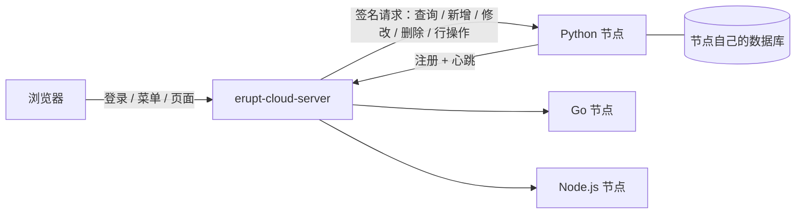

# Erupt SDK 多语言节点

Erupt SDK 让任何语言写的服务都能把自己的模型变成 erupt 管理页面。服务作为 [erupt-cloud](/zh/modules/erupt-cloud) 的**节点**运行：模型和数据留在节点上，erupt 服务端负责渲染界面、登录、菜单与权限，节点只需声明模型、提供数据读写。

> 最低版本要求：erupt 服务端 **2.4.0**。源码与发布记录见 [github.com/erupt-io/erupt-sdk](https://github.com/erupt-io/erupt-sdk)。

## 工作方式

1. 节点启动后向服务端注册，并持续心跳；退出时注销。
2. 用户在服务端打开 `<节点名>.<模型名>` 类型的菜单，服务端读取节点的模型定义，渲染表格与表单。
3. 增删改查与行操作由服务端校验权限与载荷后，签名转发给节点执行。引用解析、Excel、上传、静态选项、单元格编辑等由服务端代为完成，见 [服务端代节点完成的工作](/zh/modules/cloud-server#服务端代节点完成的工作)。

## 语言

| 语言 | 运行时要求 | 依赖 | 包 | 文档 |
| --- | --- | --- | --- | --- |
| Python | 3.9+ | 零依赖 | `erupt-sdk`（PyPI） | [Python SDK](/zh/modules/erupt-sdk/python) |
| Go | 1.21+ | 仅标准库 | `github.com/erupt-io/erupt-sdk/go` | [Go SDK](/zh/modules/erupt-sdk/go) |
| TypeScript / Node.js | Node.js 22+ | 零运行时依赖 | `erupt-sdk`（npm） | [TypeScript SDK](/zh/modules/erupt-sdk/typescript) |
| PHP | 8.1+ | 零 Composer 依赖 | `erupt-io/erupt-sdk`（Packagist） | [PHP SDK](/zh/modules/erupt-sdk/php) |
| C# / .NET | .NET 8+ | 无运行时 NuGet 依赖 | `Erupt.Sdk`（NuGet） | [.NET SDK](/zh/modules/erupt-sdk/dotnet) |
| Rust | 1.85+（数据库驱动 1.88+） | serde / serde_json / ctrlc，驱动按 feature 引入 | `erupt-sdk`（crates.io） | [Rust SDK](/zh/modules/erupt-sdk/rust) |
| Ruby | 3.1+ | 零 gem 依赖，兼容 Rack | `erupt-sdk`（RubyGems） | [Ruby SDK](/zh/modules/erupt-sdk/ruby) |
| Swift | 5.9+（macOS 13+ / Linux） | 仅 Foundation，SQLite 为可选产品 | `EruptSDK`（SwiftPM） | [Swift SDK](/zh/modules/erupt-sdk/swift) |
| Java / Kotlin | 17+ | 随 erupt 发布，无需 SDK | `erupt-cloud-node` / `erupt-cloud-node-lite` | [Java / Kotlin](/zh/modules/erupt-sdk/java) |

:::warning 版本
各语言 SDK 当前版本为 **0.1.0**，按语言分别打 tag 发布。安装前请在对应包仓库确认已发布的最新版本。
:::

## 每个 SDK 都提供的能力

- 带搜索、排序、分页的增删改查
- CHOICE、日期、日期时间、布尔、数字、文本等常用组件，按语言类型自动推断
- 引用：表格选择器与树选择器，节点只存主键，标签由服务端解析
- 行操作：单行 / 多行 / 按钮模式，可带表单、确认文案、按用户控制显隐
- DataProxy 钩子：新增默认值、校验、读写前后处理
- 服务端下发的按用户权限，以及请求签名校验
- 原始注解属性透传，并按 `schema/` 中的 JSON Schema 做类型与校验

Java 节点（Spring）实现完整的注解能力，包括子表、附件、Excel 钩子等；其他语言实现的范围见各自文档的「能力边界」。

## 与 erupt 保持同步

两个仓库之间的契约只有 `schema/` 目录：注解的 JSON Schema（`erupt-annotations.schema.json`）和字段模板（`erupt-node-defaults.json`），由 erupt 根据注解源码生成。erupt 的注解变化后，erupt-sdk 的 `sync-schema` 工作流拉取新契约、重新生成各语言代码并发起 PR；生成文件与契约不一致时各语言 CI 直接失败。

节点与服务端之间的线协议见 [PROTOCOL.md](https://github.com/erupts/erupt/blob/develop/erupt-cloud/PROTOCOL.md)。

## 一致性测试

`conformance/run.py` 扮演 erupt 服务端：注册探活、按会话下发权限、注销，并发送真实服务端会转发的请求。每种语言都必须在同一套夹具（Category / Article / Note 三个模型）上通过这些检查，包括明文 `Access-Token` 与签名两种调用方式。各语言的运行命令见对应文档的「示例与一致性测试」。

## 示例

每种语言的 `examples/blog` 都实现同一个博客模型（文章、分类、组件演示），便于逐语言对比同一套管理页面。运行后在服务端添加 `table` 类型菜单 `blog.Article`、`blog.Category` 即可看到页面。
