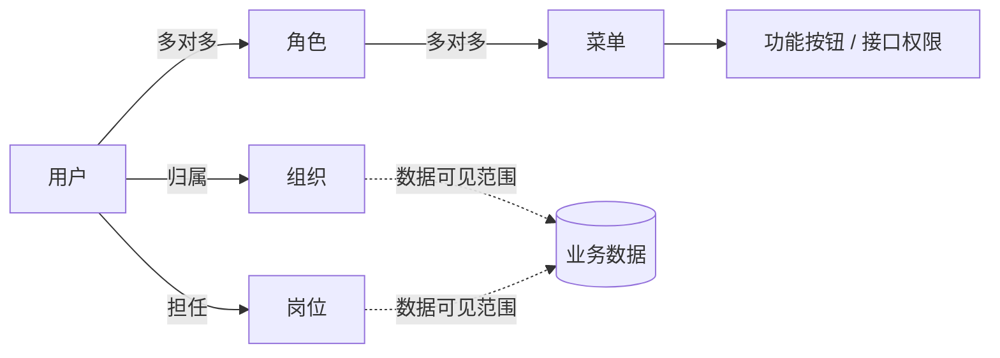

# Erupt Upms 权限管理

erupt-upms 是 Erupt 的用户权限管理系统（User Permission Management System）：用户、角色、菜单、组织、岗位、字典、Open API、在线用户与三类日志，全部由 `@Erupt` 注解生成，不需要额外写一行界面代码。

它解决的是每个后台都绕不开、又最不该重复造的那部分：**谁能登录、登录后能看到哪些菜单、在菜单里能按哪些按钮、看到哪些数据，以及事后如何追溯。**

## 引入方式

`erupt-upms` 已包含在 `erupt-admin` 中，无需单独引入：

```xml
<dependency>
  <groupId>xyz.erupt</groupId>
  <artifactId>erupt-admin</artifactId>
  <version>${erupt.version}</version>
</dependency>
```

启动后使用默认账号登录（可通过 `erupt.upms.default-account` / `default-password` 修改，见[参数配置](/zh/guide/configuration)）：

| 账号 | 密码 |
| --- | --- |
| erupt | erupt |

2.4.0 起默认账号只在每个数据库首次初始化时创建一次（记录在 `e_upms_module` 表），删掉它或改掉密码后不会在重启时重新出现。

## 权限模型



- **菜单**是权限的最小单位：一个 Erupt 类对应一个菜单，其新增 / 修改 / 删除 / 导出等按钮会自动生成为子菜单，勾选即授权。
- **角色**是菜单的集合，用户可拥有多个角色，权限取并集。
- **组织与岗位**不参与菜单授权，而是用来划定**数据可见范围**：业务实体继承 `LookerOrg` / `LookerPostLevel` / `LookerSelf` 后，非管理员只能看到本组织、本组织下级岗位或自己创建的数据。
- **超级管理员**（用户上的「管理员」开关）跳过所有菜单与数据过滤。

## 功能导航

初始化后「系统管理」目录下的菜单，与本模块各页面一一对应：

| 页面 | 解决的问题 |
|---|---|
| [菜单管理](/zh/modules/erupt-upms/menu) | 系统里有哪些页面、按钮与接口，分别用什么方式打开 |
| [角色管理](/zh/modules/erupt-upms/role) | 把菜单打包成岗位职责，并防止操作者越权分配 |
| [组织与岗位](/zh/modules/erupt-upms/org-post) | 组织树与岗位层级，以及基于它们的数据可见范围 |
| [用户管理](/zh/modules/erupt-upms/user) | 账号生命周期：密码策略、锁定、有效期、IP 白名单、重置密码 |
| [字典管理](/zh/modules/erupt-upms/dict) | 把散落在代码里的枚举变成可在线维护的 key-value |
| [Open API](/zh/modules/erupt-upms/open-api) | 给外部系统发放 APPID + Secret，以某个用户的权限调用接口 |
| [在线用户](/zh/modules/erupt-upms/online) | 谁正在线、从哪登录，一键强制下线 |
| [登录日志与操作日志](/zh/modules/erupt-upms/log) | 谁在何时何地做了什么、改前数据是什么、耗时多少、是否报错 |
| [系统日志](/zh/modules/erupt-upms/system-log) | 不登服务器，在浏览器里实时看应用日志 |
| [模块中心](/zh/modules/erupt-upms/menu#模块中心) | 装了哪些模块、各自做什么、文档在哪，并可一键关闭不用的模块菜单（2.4.0+） |

## 多租户与 @TenantId

> 2.4.0+

用户、角色、组织、岗位四张表各带一列 `tenant_id`，平台数据的值为 `"0"`。该列用 Hibernate 的 `@TenantId` 标注：每个会话绑定一个租户，对这些实体的**所有查询自动限定在会话租户内，插入时自动打上租户**，业务代码无需写任何过滤条件。登录日志、在线用户、操作日志、SSO 认证源与绑定、评论、修订等表也带同一列，同样受此约束；登录日志总是记在用户自己的租户下。

不引入 [erupt-tenant](/zh/modules/pro/erupt-tenant/) 时所有行都属于租户 `"0"`，行为与以前完全一致。引入后：

- **业务编码按租户唯一**：账号、角色 / 组织 / 岗位编码的唯一约束变为 `(tenant_id, account | code)`，不同租户可以有同名账号。原来的单列唯一索引（如 `account`）不会被 JPA 自动删除，升级时请手工 drop，SQL 见[升级指南](/zh/guide/upgrade)。
- **`UpmsTenantSessions`**：在另一个租户的会话里执行代码。`callAs / runAs(tenantId, em -> ...)` 交给你一个该租户的 `EntityManager` 并提交；`callBound / runBound(tenantId, () -> ...)` 把该租户会话绑定到当前线程，期间 `EruptDao` 及任何 `@Transactional` 服务都在该租户内运行，适合调度任务逐租户处理。`tenantId` 传 `null` 即平台；已持有会话的线程不能切换到另一个租户。
- **`EruptLambdaQuery.allTenants()`**：跨租户查询，只对这一条查询的读取生效，`delete()` 不受影响。按 id 加载其他租户的行仍返回 `null`，插入仍打上会话租户——这两件事需要对应租户的会话。
- **`UpmsMenuScope` SPI**：在角色授权之外再收窄某个用户能拥有的菜单（例如按租户订阅的功能包），同时作用于登录后的菜单树和角色编辑时可勾选的菜单；返回 `null` 表示不收窄。
- **`UpmsTenantLogin` SPI**：由 erupt-tenant 实现，负责把租户编码解析为租户 id、决定该租户能否登录并签发租户 token、给出租户登录页路径；SSO 等不经过租户密码表单的登录都通过它进入租户。没有实现时所有登录都属于平台。

```java
@Resource
private UpmsTenantSessions tenantSessions;

// 平台侧为某个租户创建管理员
tenantSessions.runAs(tenantId, em -> em.persist(admin));

// 调度任务里逐租户执行，服务代码不必知道租户的存在
tenantSessions.runBound(tenantId, () -> orderService.settle());

// 平台运营者列出所有租户的用户
eruptDao.lambdaQuery(EruptUser.class).allTenants().list();
```

## 可信代理与客户端 IP

登录锁定、验证码计数、IP 白名单与登录 / 操作日志都依赖客户端 IP。2.4.0 起 `X-Forwarded-For` 只在直连方是**可信代理**时才被采信，从右往左跳过所有可信代理取第一个非代理地址；其他来源的请求一律以直连地址为准，伪造请求头无法冒充 IP。`Proxy-Client-IP`、`WL-Proxy-Client-IP` 等头不再读取。

```yaml
erupt:
  upms:
    # 可信代理的 IP 或 CIDR，逗号分隔；默认回环地址与 RFC 1918 内网段
    trusted-proxies: 127.0.0.0/8,::1,10.0.0.0/8,172.16.0.0/12,192.168.0.0/16
```

反向代理不在内网段（如公网上的负载均衡）时把它的地址加进来；留空表示不信任任何代理。

## 相关扩展点

权限系统的代码级扩展分散在「进阶」章节，这里列出入口：

| 需求 | 文档 |
|---|---|
| 单点登录、自定义登录逻辑（LDAP / 短信验证码）、自行签发 Token | [登录与认证](/zh/advanced/auth) |
| 替换登录页 | [登录与认证 → 自定义登录页](/zh/advanced/auth#自定义登录页) |
| 自己写的接口要求登录或菜单权限 | [REST API 接口权限](/zh/advanced/rest-api) |
| 按组织 / 岗位 / 创建人过滤数据 | [PreDataProxy 与 Looker](/zh/advanced/pre-data-proxy) |
| 字典作为下拉选项 | [单选 CHOICE → 字典选项](/zh/field-types/choice#字典选项) |
| 在代码里声明模块菜单、分组与文档链接 | [插件开发](/zh/advanced/plugin) |
| 多租户 SaaS：租户隔离、租户登录页 | [erupt-tenant](/zh/modules/pro/erupt-tenant/) |
| 水印、验证码次数、Session 时长等 | [参数配置](/zh/guide/configuration) |
